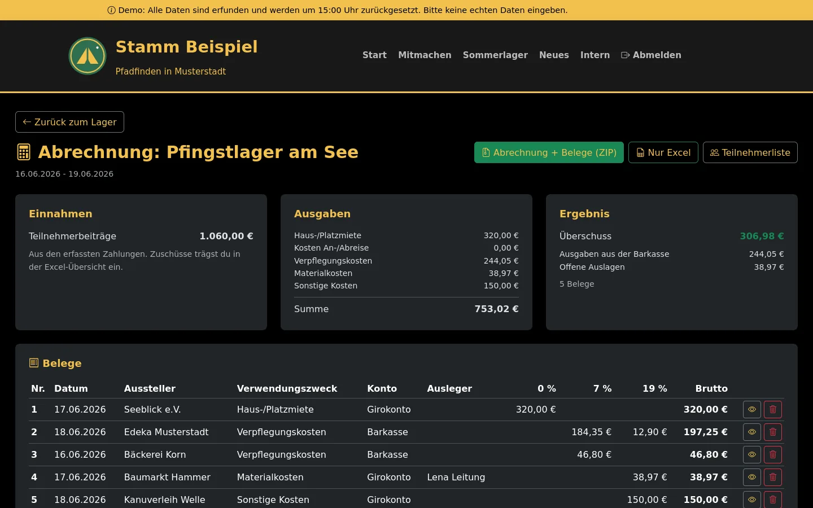
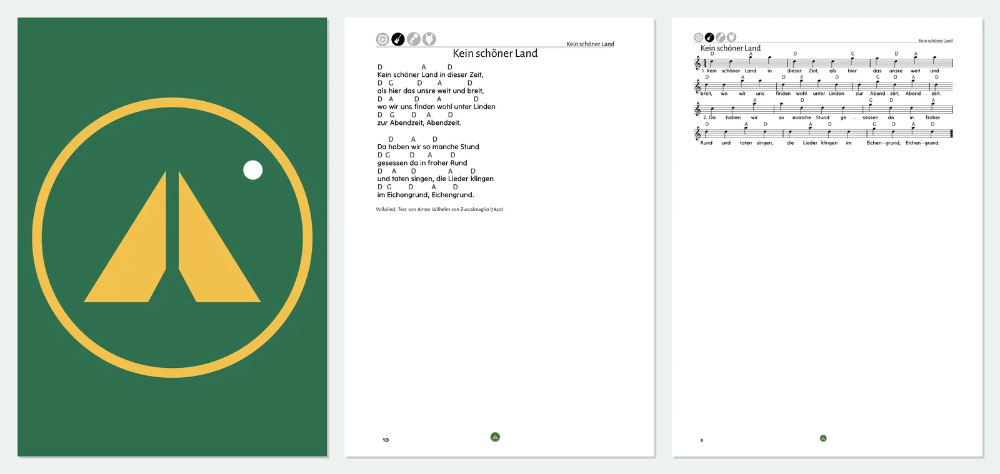

# StammTools

**Verwaltung und Website für Pfadfinder*innen-Stämme.**
Weniger Zettelkram, mehr Zeit fürs Lager.

[Website](https://stammtools.dev-fox.me) · [Demo anfragen](mailto:kontakt@stammtools.dev-fox.me?subject=Demo%20StammTools) · [Sicherheitslücke melden](https://stammtools.dev-fox.me/sicherheit.html)

---

StammTools bündelt, was im Stamm sonst über Excel-Listen, Mails und Schuhkartons verteilt ist.
Entstanden im Alltag eines Stamms, entwickelt von [@DEV-F0x](https://github.com/DEV-F0x).

| | |
|---|---|
| ⛺ **Lager & Anmeldung** | Anmeldung über ein Formular auf eurer Website, Teilnehmerliste, Raten mit Fälligkeit, GiroCode zum Überweisen |
| 🧾 **Lagerabrechnung** | Belege hochladen, Auslagen und Umbuchungen, fertige Excel-Abrechnung plus ZIP mit allen Belegen |
| ✅ **Kassenprüfung** | Jeden Posten einzeln abhaken, mit passendem Kontoumsatz daneben, jede Änderung protokolliert |
| 🏦 **Finanzen** | Kontoumsätze direkt von der Bank, Tags und Regeln, Lagerbeiträge automatisch als bezahlt gebucht |
| 📄 **Zuschussanträge** | Antrag und Teilnehmerlisten fürs Jugendamt, direkt aus den Lagerdaten befüllt |
| 🎸 **Liederbuch** | Lieder mit Akkorden, daraus eigene Liederbücher als druckfertiges PDF, auch mit Noten |
| 👕 **Rüstwart & Shop** | Bestand mit Größen, Verkäufe und Kasse, interner Shop und Vorbestellungen der Gruppen |
| 🌐 **Website & Wiki** | Seiten, Blog, Formulare und internes Wiki mit Baukasten-Editor |

  
  

## Für euren Stamm

- **Euer Look:** Name, Logo, Farben und Adresse eures Stamms.
- **Eure Daten:** StammTools läuft auf eurem eigenen Server.
- **Eure Auswahl:** Ihr nehmt nur die Module, die ihr braucht.
- **Euer Login:** Mitglieder melden sich mit ihrem Vereinskonto an, z. B. bei EasyVerein. Rechte gibt es pro Bereich.

Es gibt keine festen Preise. Wir schauen gemeinsam, was zu euch passt, und machen euch ein Angebot.
Die Demo mit erfundenen Daten zeigen wir euch gern:
**[kontakt@stammtools.dev-fox.me](mailto:kontakt@stammtools.dev-fox.me)**

## Sicherheit

Eine Schwachstelle in StammTools oder einer StammTools-Instanz gefunden? Bitte meldet sie
vertraulich an [security@stammtools.dev-fox.me](mailto:security@stammtools.dev-fox.me). Wie das
geht, steht in unserer [Sicherheitsrichtlinie](https://stammtools.dev-fox.me/sicherheit.html)
(maschinenlesbar: [security.txt](https://stammtools.dev-fox.me/.well-known/security.txt)).
